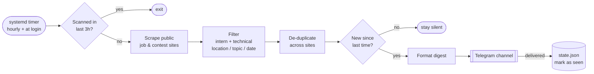
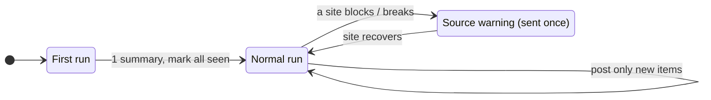

# Da Nang Intern & Contest Finder

A small Linux bot that finds new **software internships** and **tech contests / hackathons** and posts them to Telegram. It runs quietly in the background and only speaks up when something is new.

## How it works





Scraping is polite: a fixed User-Agent, `robots.txt` respected, ≥ 2 s between requests, and a site is skipped for the run if it blocks or shows a CAPTCHA. No logins, cookies, proxies or CAPTCHA solving.

## Setup

Requires Python 3.13 and `systemd --user`.

```bash
python3 -m venv .venv && .venv/bin/pip install -r requirements.txt
cp .env.example .env && chmod 600 .env    # then fill it in (below)
.venv/bin/python -m finder --dry-run      # preview, sends nothing
scripts/install                           # start the background timer (no sudo)
```

**Telegram:** create a bot with `@BotFather` (`/newbot`), create a private channel, and add the bot as an admin with *Post Messages*. The channel ID starts with `-100`.

**`.env`:**

| Key | Value |
|---|---|
| `TELEGRAM_BOT_TOKEN` | token from BotFather. Never commit it. |
| `TELEGRAM_JOBS_CHAT_ID` | channel for jobs |
| `TELEGRAM_CONTESTS_CHAT_ID` | channel for contests (can be the same as jobs) |
| `JOB_AREAS` | `danang`, `remote`, `other`, comma-separated. Unset = all |

## Commands

```bash
.venv/bin/python -m finder [--dry-run] [--seed] [--force] [--channel jobs|contests] [--sources a,b]
```

- `--dry-run`: print results only (jobs unless `--channel contests`).
- `--seed`: mark everything current as seen without sending.
- `--force`: ignore the 3-hour guard.

Exit codes: `0` ok / nothing to do, `1` Telegram or state-file error, `2` bad configuration.

## Manage

```bash
systemctl --user list-timers danang-intern-finder.timer    # next run
journalctl --user -u danang-intern-finder.service -e       # logs
systemctl --user disable --now danang-intern-finder.timer  # pause
scripts/uninstall                                          # remove (keeps .env and state/)
```

**Nothing arrives?** Check that the bot is a channel admin and the chat ID is right, and run `--dry-run` to see whether anything matches. To start over, delete `state/state.json`.
